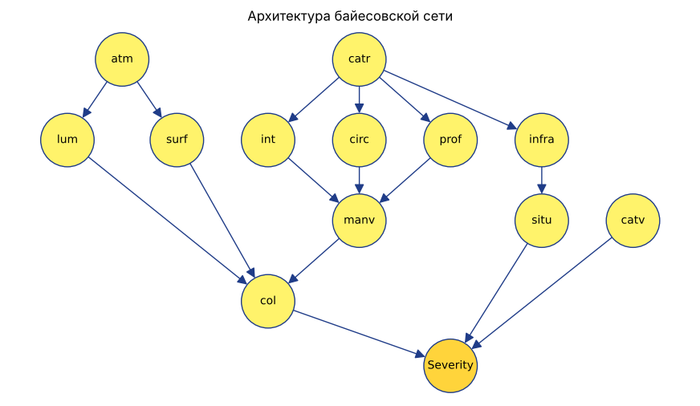

# Задача «Тяжесть ДТП»

## Условие

Создать алгоритм предиктивной аналитики на основе **ненаивной** байесовской сети: по сценарию ДТП предсказать итоговую степень тяжести. Данные — первые 10 000–20 000 записей таблицы `Bayes_start_table_1.xlsx`.

Признаки: `lum` (освещённость), `int` (пересечение), `atm` (погода), `col` (тип столкновения), `catr` (категория дороги), `circ` (режим движения), `prof` (уклон), `surf` (покрытие), `infra` (инфраструктура), `situ` (место аварии), `catv` (категория ТС), `manv` (манёвр).

Целевой узел `Severity`: grav 1 → S0 (не пострадал), 2 → S1 (погиб), 3 → S2 (госпитализирован), 4 → S3 (лёгкая травма).

## Архитектура

## Результат

| Модель | Точность на тесте |
| --- | --- |
| Ненаивная сеть (эта архитектура) | 0.425 |
| Наивная сеть | 0.418 |
| «Всегда S0» (базовая линия) | 0.420 |

Предобработка по коду преподавателя: 20 000 записей → 5 727 после фильтра категорий ТС и тяжести. Разбиение 80/20 по авариям, параметры — байесовская оценка (BDeu).

## Ограничение данных

Таблица склеена из трёх таблиц базы ДТП по номеру строки, а не по номеру аварии: `catv, manv` — 94 493 строки (ТС), `lum…catr` — 55 302 (аварии), `grav` — 126 662 (участники). Признаки и тяжесть в одной строке относятся к разным авариям, поэтому точность не выше базовой линии; поиск структуры (Hill Climb) не находит связей тяжести с признаками.

## Файлы

- `dtp_bn.ipynb` — ноутбук (данные загружаются с Google Диска автоматически);
- `dtp.net` — обученная сеть для UnBBayes (File → Open);
- `network.png` — архитектура сети.
