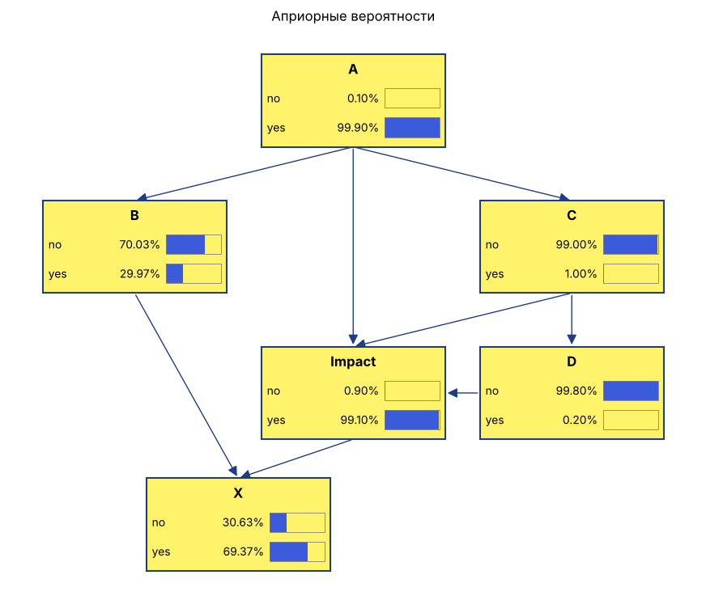

# Задача «Метеорит»

## Условие

- A — учёные уверены, что метеорит попадёт (расчёт курса — столкновение): P(A) = 0.999
- B — эвакуация в убежище спасает: P(B | A) = 0.3
- C — метеорит взорвали: P(C | A) = 0.01
- D — после взрыва большие обломки: P(D | C) = 0.2

Найти: P(уничтожение человечества).

## Структура сети

A → B, A → C, C → D; A, C, D → Impact (удар); Impact, B → X (уничтожение).

Impact = A и (не C или D), X = Impact и не B — детерминированные узлы.

## Ответ

P(X) = P(A) · P(¬B | A) · (P(¬C | A) + P(C | A) · P(D | C))
     = 0.999 · 0.7 · (0.99 + 0.01 · 0.2) = **0.6937056**

Допущения: при A = нет метеорит не взрывают и не эвакуируются; без взрыва обломков нет.
