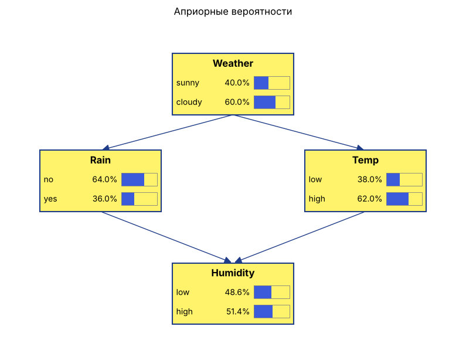

# Задача «Погода»

## Условие

- P(солнечно) = 0.4, P(облачно) = 0.6
- P(дождь | облачно) = 0.6
- P(высокая температура | солнечно) = 0.8, P(высокая температура | облачно) = 0.5
- P(высокая влажность | высокая темп., дождь) = 0.9
- P(высокая влажность | высокая темп., нет дождя) = 0.5
- P(высокая влажность | низкая темп., дождь) = 0.4
- P(высокая влажность | низкая темп., нет дождя) = 0.3

Найти: а) P(высокая влажность); б) P(солнечно | высокая влажность).

## Структура сети

Weather → Rain, Weather → Temp, Rain → Humidity, Temp → Humidity.

## Ответ

а) P(высокая влажность) = 0.4 · 0.46 + 0.6 · 0.55 = **0.514**

б) P(солнечно | высокая влажность) = 0.4 · 0.46 / 0.514 ≈ **0.358**

Допущение: P(дождь | солнечно) = 0 — в условии не задана.
